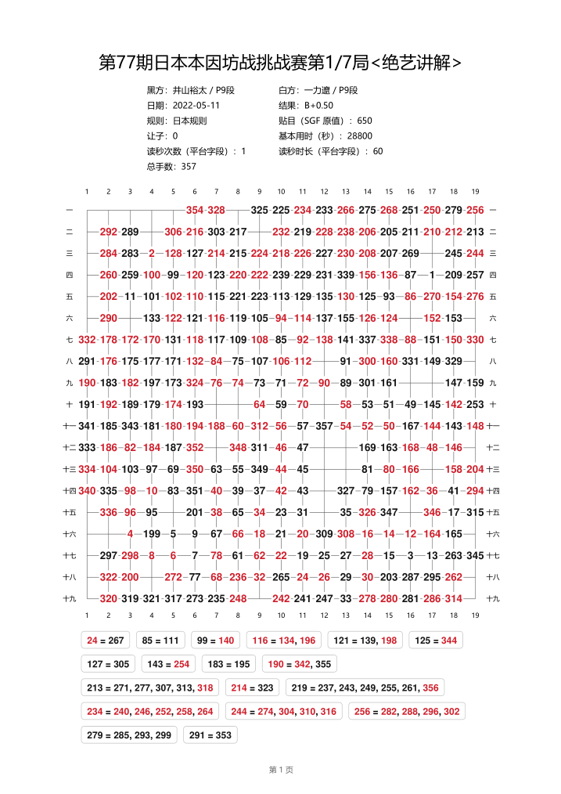

# SGF to PDF

将 SGF 棋谱转换为可直接打印的 A4 数字手记棋谱：黑棋黑字、白棋红字，重复落点在棋盘下方分组标注。

## 效果预览

以下为 `inputs/` 中棋谱生成的单页 PDF：上方为整体居中的对局信息，下方为传统坐标棋盘及分组显示的重复落点记录。



## 安装

使用 Python 3.10 或以上，在项目目录执行：

```powershell
python -m pip install -r requirements.txt
```

如使用编辑器，请选择安装了依赖的 Python 解释器。也可创建项目虚拟环境：

```powershell
python -m venv .venv
.venv\Scripts\python.exe -m pip install -r requirements.txt
```

然后在编辑器中选择 `.venv/Scripts/python.exe`，使用该解释器运行脚本。

Windows 自动读取系统中文字体。其他系统需将 `SGF_FONT` 环境变量设为中文 TrueType 字体文件路径。

## 批量转换

将 19 路 SGF 棋谱放入 `inputs/` 或脚本所在目录，执行：

```powershell
python sgf_to_pdf.py
```

生成的 PDF 保存到 `output/`，同名文件会被覆盖。仅扫描这两个目录，不递归子目录。

## 指定棋谱

```powershell
python sgf_to_pdf.py "inputs/棋谱.sgf"
```

一次指定多个棋谱：

```powershell
python sgf_to_pdf.py "inputs/棋谱1.sgf" "inputs/棋谱2.sgf"
```

## 指定输出路径

```powershell
python sgf_to_pdf.py "inputs/棋谱.sgf" -o "output/手记.pdf"
```

`-o` 仅用于单个输入文件。批量转换时，请为不同棋谱使用不同的文件名。
